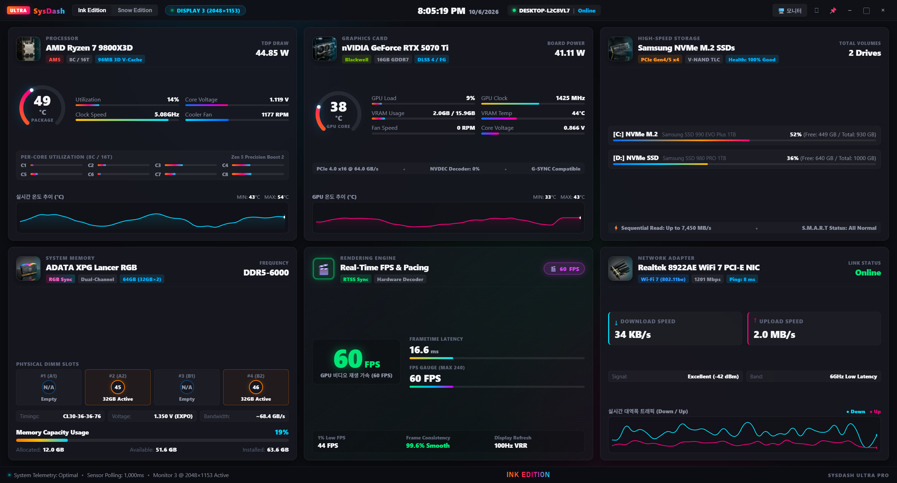
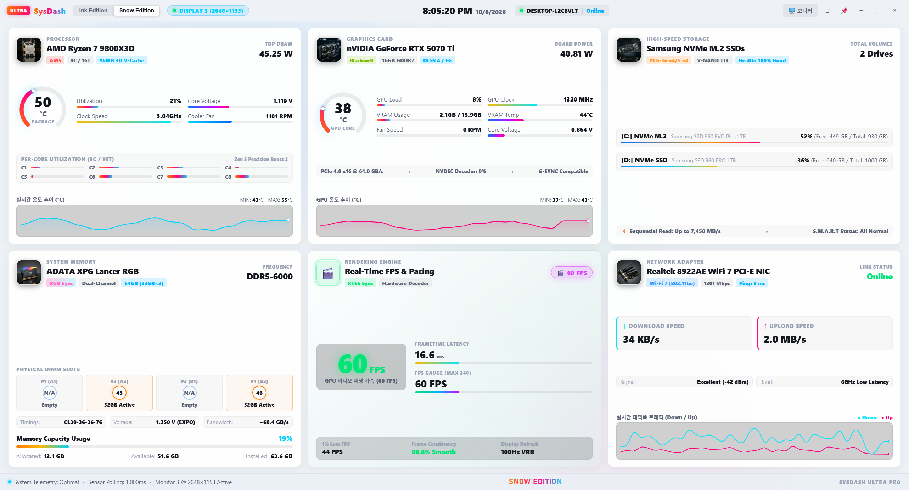

# 🖥️ SysDash WinVer (Windows Dedicated Hardware Dashboard)

[](https://github.com/kimjiho680629/Windows-SysDash)
[](https://github.com/kimjiho680629/Windows-SysDash)
[](https://github.com/kimjiho680629/Windows-SysDash)
[](https://github.com/kimjiho680629/Windows-SysDash)

> **SysDash WinVer**는 Windows 전용으로 제작된 고성능 실시간 하드웨어 텔레메트리 대시보드입니다.  
> 서브 모니터(기본값: 모니터 3, 2048 × 1152 초광폭 해상도)에 완벽하게 최적화된 **3열 하이테크 사이버네틱 레이아웃**, **실물 부품 사진 홀로그램 스캔 연동**, **RTSS 게이밍 프레임/FPS 레이더**, **Windows 부팅 시 자동 시작 및 다중 디스플레이 스마트 안착 가드**를 제공합니다.

---

## 📸 미리보기 (Preview)

### Ink Edition (다크 사이버 네온 모드)


### Snow Edition (클린 화이트 모드)


---

## ✨ 핵심 기능 (Key Features)

1. **🖥️ 서브 모니터(모니터 3) 전용 3열 와이드 레이아웃**
   - 2048 × 1152 또는 다중 모니터 환경의 특정 모니터(X=3425, Y=1446 등)를 자동 감지하여 창이 열리자마자 보더리스 전체화면으로 가득 채웁니다.
   - 상단 컨트롤 바에서 `[🖥️ 모니터]` 드롭다운 버튼을 통해 연결된 모든 모니터 간 자유로운 원클릭 이동을 지원합니다.
   - `[⛶]` 전체화면 토글, `[📌]` Always on Top 고정, 최소화/최대화 지원.

2. **📸 실제 장착 부품 스튜디오 실물 사진 & 홀로그램 스캐닝 연동**
   - 시스템에 장착된 실제 부품의 초고화질 사진(CPU, GPU, RAM, SSD, Network)을 각 카드 헤더에 배치.
   - 마우스 호버 시 사이버 네온 림라이트와 실시간 레이저 스캐닝 빔 펄스 애니메이션이 동작합니다.

3. **🎮 RTSS(RivaTuner Statistics Server) 게이밍 FPS 초저지연 연동**
   - C# 네이티브 공유 메모리 리더([bin/RtssReader.exe](bin/RtssReader.exe))를 통해 렌더링 중인 게임(예: Diablo IV 등)의 FPS, 프레임타임(ms), 1% Low FPS, 부드러움 지수를 지연 없이 실시간 수집.

4. **🚀 윈도우 부팅 시 자동 실행 & 지연 인식 스마트 안착 가드**
   - 레지스트리(`HKCU\...\Run`) 및 시작프로그램 폴더 이중 등록 지원.
   - 부팅 직후 다중 모니터 드라이버 로딩 지연 시에도 `display-added`, `display-metrics-changed` 이벤트와 1초/3초/7초 안전 타이머가 작동하여 대상 모니터로 자동 이동 및 확장.
   - 앱 상단 헤더의 **`[● 모니터3 자동시작: ON]`** 네온 버튼으로 언제든 원클릭 켜기/끄기 가능.

5. **🎨 Ink & Snow 듀얼 테마 지원**
   - **Ink Edition**: 딥 매트 다크 바탕에 사이언/핑크/오로라 글로우 네온 효과.
   - **Snow Edition**: 밝고 모던한 클린 화이트 하이테크 테마.

---

## 🛠️ 시스템 요구 사항 (Prerequisites)

* **운영체제**: Windows 10 / 11 (64-bit)
* **런타임 환경**: Node.js v18.x 이상 (v20+ LTS 권장) & npm
* **하드웨어 드라이버**: NVIDIA GPU 사용 시 최신 Game Ready / Studio 드라이버 (`nvidia-smi` 지원)
* **선택 사항 (게임 FPS 모니터링 시)**: [MSI Afterburner / RTSS (RivaTuner Statistics Server)](https://www.guru3d.com/download/rtss-rivatuner-statistics-server-download/)
* **권장 폰트**: [FiraCode Nerd Font](https://github.com/ryanoasis/nerd-fonts/releases) (없을 경우 시스템 Segoe UI / Cascadia Code로 대체)

---

## 🔄 윈도우 새로 설치(Clean Install) 시 완벽 복원 & 실행 가이드

윈도우를 포맷했거나 새로 설치한 PC에서 SysDash WinVer를 처음부터 다시 구성하는 단계별 방법입니다.

### 1단계: 필수 프로그램 및 폰트 설치
1. **Node.js 설치**: [Node.js 공식 홈페이지](https://nodejs.org/)에서 LTS 버전을 설치합니다.
2. **Git 설치**: [Git for Windows](https://git-scm.com/) 설치.
3. **폰트 설치 (권장)**: `FiraCode Nerd Font`를 설치하여 코드/아이콘 및 타이포그래피 품질을 극대화합니다.
4. **RTSS 설치 (선택)**: 게임 내 실시간 FPS 측정을 원할 경우 RTSS를 실행해 둡니다.

### 2단계: 저장소 클론 및 패키지 설치
터미널(PowerShell 또는 CMD)을 열고 실행합니다:
```powershell
# 1. 저장소 클론
git clone https://github.com/kimjiho680629/Windows-SysDash.git C:\Gemini_job\SysDash
cd C:\Gemini_job\SysDash

# 2. 의존성 패키지 설치
npm install
```

### 3단계: C# 네이티브 바이너리 빌드 (선택 사항)
> 💡 저장소에 이미 사전 컴파일된 [SysDash.exe](SysDash.exe) 및 [bin/RtssReader.exe](bin/RtssReader.exe)가 포함되어 있으므로 보통 이 단계는 생략해도 됩니다. 바이너리를 새로 컴파일해야 할 때만 실행하세요.

```powershell
# .NET Framework csc 컴파일러를 이용한 빌드
$csc = "C:\Windows\Microsoft.NET\Framework64\v4.0.30319\csc.exe"

# 1) 메인 런처 빌드 (콘솔 창 없는 무콘솔 GUI 런처)
& $csc /target:winexe /out:SysDash.exe src\native\Launcher.cs

# 2) RTSS 메모리 맵 리더 빌드
& $csc /target:exe /out:bin\RtssReader.exe src\native\RtssReader.cs
```

### 4단계: 독립 실행 배포 패키지 빌드 (Standalone Package)
`node_modules` 전체를 직접 구동하지 않고 단독 실행 폴더를 생성하려면 제공된 빌드 스크립트를 실행합니다:
```powershell
powershell -ExecutionPolicy Bypass -File scratch/build_standalone.ps1
```
* 빌드가 완료되면 `release\SysDash\SysDash.exe`가 생성됩니다.

### 5단계: 실행 및 부팅 시 자동 시작 등록
1. 프로젝트 루트의 **`SysDash.exe`**를 더블 클릭하거나 `npm start`를 실행합니다.
2. 프로그램이 열리면 모니터 3(또는 대상 모니터)으로 자동 이동하여 전체화면으로 실행됩니다.
3. 상단 헤더 우측의 **`[● 모니터3 자동시작]`** 버튼이 켜져 있는지 확인합니다 (클릭하여 ON/OFF 토글 가능).
   - ON 상태가 되면 Windows 레지스트리 및 시작프로그램 폴더에 자동 등록되어 다음 부팅부터 PC를 켤 때 자동으로 실행됩니다.

---

## 🧩 새로운 시스템에 적용하기 (새 PC / 새 하드웨어 커스터마이징 가이드)

PC 부품을 교체했거나, 완전히 다른 새 컴퓨터에 SysDash를 적용할 경우 아래 절차에 따라 내 하드웨어에 맞게 설정할 수 있습니다.

### 1단계: 원클릭 시스템 사양 자동 진단 스크립트 실행
프로젝트에 포함된 하드웨어 사양 감지 스크립트를 실행합니다:
```powershell
powershell -ExecutionPolicy Bypass -File scratch/detect_system_specs.ps1
```
이 스크립트는 다음 정보를 즉시 감지하여 터미널에 출력합니다:
- **연결된 모니터 목록**: 각 모니터 번호, 해상도(Width x Height), 시작 좌표(X, Y)
- **CPU**: 모델명, 코어 수, 스레드 수, 기본 클럭
- **GPU**: 모델명, VRAM 용량, 드라이버 버전
- **RAM**: 전체 용량, 장착된 슬롯 번호 및 제조사, 동작 속도(MHz)
- **스토리지**: 장착된 드라이브 모델명(NVMe/SATA), 볼륨(C:, D: 등) 잔여 용량
- **네트워크**: 활성 인터페이스명, 링크 속도(1.2 Gbps, 2.5 Gbps 등)

---

### 2단계: 소스 코드 커스터마이징 포인트

#### ① 타겟 모니터 및 좌표 설정 (`src/main.js`)
SysDash를 띄울 모니터가 다른 모니터이거나 해상도가 다른 경우:
```javascript
// src/main.js - findMonitor3() 함수 수정
function findMonitor3() {
  const displays = screen.getAllDisplays();
  
  // 새 모니터의 X좌표나 해상도에 맞게 조건을 수정합니다.
  let target = displays.find(d => d.bounds.x === <내_모니터_X좌표> || (d.bounds.width === <가로해상도> && d.bounds.height === <세로해상도>));
  if (target) return target;

  // 원하는 모니터 인덱스 지정 (예: 2번째 모니터면 displays[1], 3번째면 displays[2])
  return displays[2] || screen.getPrimaryDisplay();
}
```

#### ② 하드웨어 수집 기본값 설정 (`src/collector.js`)
내 하드웨어의 브랜드 및 기본 스펙을 설정합니다:
```javascript
// src/collector.js
this.ramSpeed = 'DDR5-6000'; // 내 RAM 규격 (예: DDR4-3200, DDR5-5600 등)

// CPU 기본값
this.cpuStatic = {
  manufacturer: 'AMD', // 또는 'Intel'
  brand: 'Ryzen 7 9800X3D', // 내 CPU 모델명
  speed: 4.7,
  cores: 8
};

// GPU 기본값 (NVIDIA 외 환경이거나 폴백 값)
name: 'NVIDIA GeForce RTX 5070 Ti',
vramTotal: 16.0 // 내 VRAM 용량 (GB)
```

#### ③ UI 타이틀 및 텍스트 수정 (`src/renderer/index.html`)
각 부품 카드에 적힌 타이틀과 배지 텍스트를 내 부품에 맞게 수정합니다:
- **CPU 섹션**:
  ```html
  <h2 class="component-name" id="cpuName">AMD Ryzen 7 9800X3D</h2>
  <span class="tag-pill tag-amd">AM5</span> <!-- Intel의 경우 LGA1700 등 -->
  <span class="tag-pill">8C / 16T</span>
  ```
- **GPU 섹션**:
  ```html
  <h2 class="component-name" id="gpuName">NVIDIA GeForce RTX 5070 Ti</h2>
  <span class="tag-pill">16GB GDDR7</span>
  ```
- **RAM 섹션**:
  ```html
  <span id="ramSpec">ADATA XPG Lancer DDR5-6000 64GB (32GB×2)</span>
  ```
- **스토리지 & 네트워크**:
  - C:, D: 드라이브 모델명(예: Samsung 990 PRO 등)
  - 네트워크 어댑터명(예: WiFi 7, Intel 2.5GbE LAN 등)

#### ④ 실물 부품 사진 교체 (`src/renderer/assets/hardware/`)
실제 장착된 부품 사진을 찍거나 스튜디오 컷 이미지를 준비하여 아래 파일명으로 교체합니다:
- `cpu.jpg`: CPU 프로세서 또는 쿨러 사진
- `gpu.jpg`: 그래픽카드 슈라우드/팬 실물 사진
- `ram.jpg`: 메모리 방열판 실물 사진
- `ssd.jpg`: M.2 NVMe SSD 실물 사진
- `net.jpg`: 무선랜 카드/안테나 또는 메인보드 I/O 사진

> 💡 **Tip**: 가로세로 1:1 비율 또는 정사각 고화질(500×500px 이상) JPG 이미지를 권장합니다. 교체 즉시 UI의 네온 림라이트 및 홀로그램 스캔 효과가 그대로 적용됩니다.

#### ⑤ 해상도별 반응형 스타일 조절 (`src/renderer/styles.css`)
만약 서브 모니터 해상도가 `2048 × 1152`가 아니라 FHD(`1920 × 1080`), QHD(`2560 × 1440`), 4K(`3840 × 2160`)인 경우:
```css
/* src/renderer/styles.css */
/* 3열 그리드 컬럼 비율 조절 */
.wide-grid {
  display: grid;
  grid-template-columns: 1.15fr 1.25fr 1.1fr; /* 각 열의 너비 비율 */
  gap: 16px;
}
```

---

## 📁 프로젝트 폴더 구조

```text
SysDash/
├── SysDash.exe                  # [메인 실행 파일] C# 무콘솔 GUI 런처
├── SysDash_Documentation.md     # 시스템 상세 명세 및 기술 문서
├── README.md                    # 사용자 및 복원 가이드 문서
├── package.json                 # Electron 및 패키지 설정
├── .gitignore                   # 불필요한 빌드 산출물 제외
├── preview_wide_ink.png         # Ink Edition 전체화면 스크린샷
├── preview_wide_snow.png        # Snow Edition 전체화면 스크린샷
│
├── bin/
│   └── RtssReader.exe           # C# RTSS 고속 공유 메모리 연동 리더
│
├── src/
│   ├── main.js                  # Electron 메인 프로세스 (모니터 가드, 자동 실행, IPC)
│   ├── preload.js               # IPC 브릿지 보안 계층
│   ├── collector.js             # 실시간 센서 텔레메트리 엔진
│   ├── native/
│   │   ├── Launcher.cs          # C# SysDash.exe 소스 코드
│   │   └── RtssReader.cs        # C# RtssReader.exe 소스 코드
│   └── renderer/
│       ├── index.html           # 3열 와이드 대시보드 UI
│       ├── styles.css           # 사이버 네온 반응형 스타일시트
│       ├── app.js               # 게이지 및 스파크라인 렌더링 로직
│       └── assets/hardware/     # 하드웨어 실물 사진 에셋 (cpu, gpu, ram, ssd, net)
│
├── scratch/
│   ├── detect_system_specs.ps1  # 새 시스템 사양 및 모니터 자동 진단 스크립트
│   ├── build_standalone.ps1     # 무설치 독립형 패키지 빌드 스크립트
│   └── check_rtss.ps1           # RTSS 연동 진단 스크립트
│
├── SystemFont/                  # [시스템 폰트 도구 모음]
│   ├── README.md                # 폰트 변경기 전용 사용 설명서
│   ├── SysFontChanger.exe       # C# WPF GUI 글꼴 변경 실행 파일
│   ├── SysFontChanger.cs        # C# WPF 전체 소스 코드
│   ├── SysFontChanger.manifest  # 관리자 권한 UAC 매니페스트
│   ├── sys_font_changer.py      # Python 글꼴 변경 스크립트
│   └── FontBackups/             # 원본 레지스트리 자동 백업 폴더
│
└── push_to_github.bat           # 원클릭 GitHub 푸시 스크립트
```

---

## 💡 유용한 팁 & 트러블슈팅

* **RTSS FPS가 0으로 표시될 때**:
  - RivaTuner Statistics Server가 백그라운드에서 실행 중인지 확인하세요.
  - 관리자 권한이 필요한 게임의 경우 RTSS도 관리자 권한으로 실행되어야 메모리 맵을 읽을 수 있습니다.
* **NVIDIA GPU 전력/온도가 잡히지 않을 때**:
  - 명령 프롬프트에서 `nvidia-smi`를 입력하여 정상 출력되는지 확인하세요. 드라이버가 최신 버전이어야 합니다.
* **모니터 3 자동 시작 해제**:
  - 앱 헤더 상단의 `[● 모니터3 자동시작]` 버튼을 한 번 클릭하면 즉시 OFF 상태로 전환되며 시작프로그램 등록이 안전하게 해제됩니다.

---

## 📄 라이선스 (License)

이 프로젝트는 개인 및 커스텀 시스템 빌드를 위해 자유롭게 사용 및 수정할 수 있습니다.
